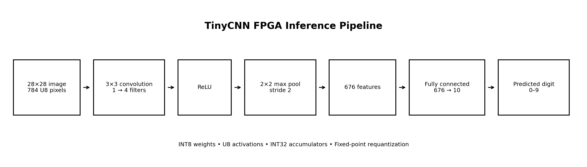
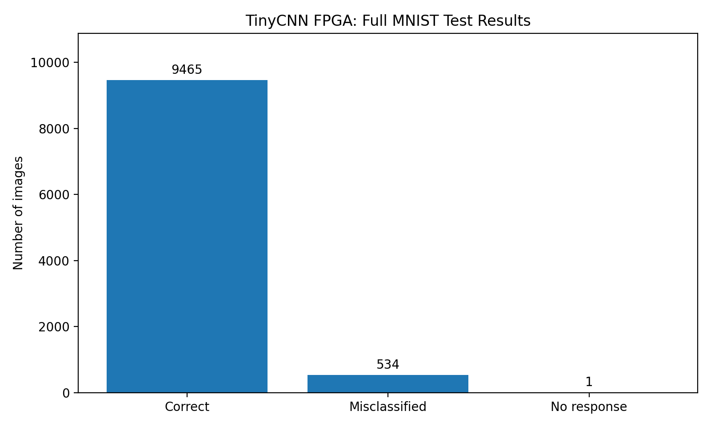
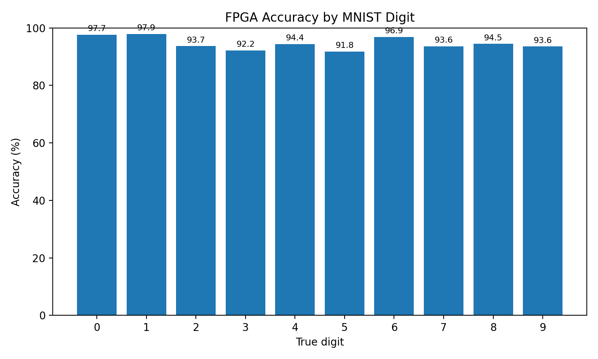
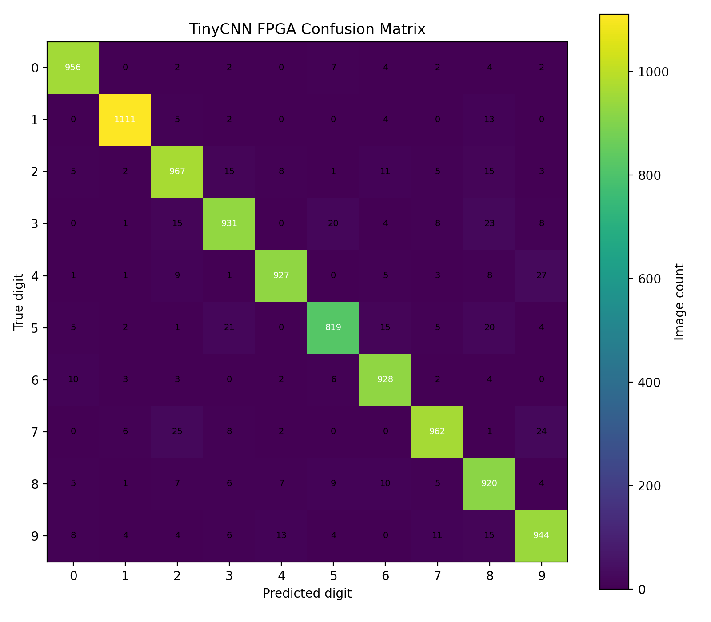
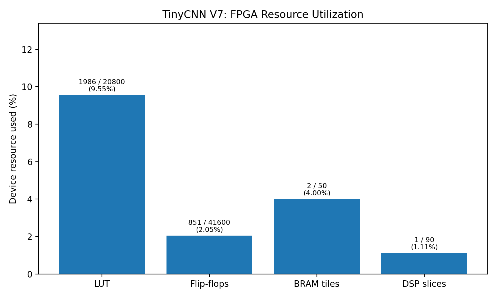

# TinyCNN FPGA Edge AI — MNIST Handwritten Digit Classification

A quantized convolutional neural network implemented in Verilog and deployed on the Digilent Basys 3 FPGA (Xilinx Artix-7 XC7A35T). The system receives 28 × 28 grayscale MNIST images over UART, performs inference in FPGA logic, and returns a predicted digit from 0 to 9.

This project demonstrates RTL implementation, fixed-point neural-network arithmetic, FPGA implementation and timing analysis, UART-based hardware testing, and dataset-level validation.

## Project status

The V7 implementation has completed hardware validation on the Basys 3 board.

| Validation metric | Recorded result |
|---|---:|
| Image attempts | 10,000 |
| Predictions received | 9,999 |
| Correct predictions | 9,465 |
| Misclassified received predictions | 534 |
| Missing responses | 1 |
| Accuracy among received predictions | 94.66% |
| Correct predictions / all attempts | 94.65% |

Accuracy among received predictions is 9,465 / 9,999 = 94.66%. Across all 10,000 attempts, the correct-prediction rate is 94.65%. The missing response is a communication outcome, not a classification error.

## Architecture



The inference pipeline is:

1. Receive a 28 × 28 grayscale image containing 784 unsigned 8-bit pixels.
2. Apply a 3 × 3 valid convolution using four filters and one input channel.
3. Apply ReLU activation.
4. Apply 2 × 2 max pooling with stride 2.
5. Flatten the pooled output into 676 features.
6. Apply a fully connected layer with 676 inputs and 10 output classes.
7. Return the predicted class through UART and display the class value on four board LEDs.

### Numerical representation

| Component | Representation or setting |
|---|---|
| Input pixels | Unsigned 8-bit (U8) |
| Weights | INT8 |
| Activations | U8 |
| Accumulators | INT32 |
| Requantization multiplier | 54688 |
| Requantization shift | 24 |
| Output classes | 10 |

The recorded fixed-point parameters are taken from the project implementation. Further bit-exact equivalence claims require verification against the actual weight ROM contents and software reference.

## Hardware and software requirements

### Hardware

- Digilent Basys 3 development board.
- Xilinx Artix-7 XC7A35T FPGA.
- USB connection for programming and UART communication.
- Windows PC.

### Software

- Windows PowerShell.
- Xilinx Vivado 2025.1.
- Python 3.12 at `C:\Python312\python.exe`.
- The MNIST IDX dataset used by the project exporter.
- The project's RTL, ROM, model, scripts, and validation files.

| Configuration | Value |
|---|---|
| FPGA part | `xc7a35tcpg236-1` |
| Main clock | 100 MHz |
| Clock input | W5 |
| UART baud rate | 115200 |
| UART format | 8-N-1 |
| Recorded hardware test port | COM4 |

Use the COM port assigned to your own board. COM4 is the port used for the recorded validation, not a universal setting.

## UART protocol

The host sends one image using the following packet format:

| Field | Size |
|---|---:|
| Synchronization byte 1 | 1 byte: `A5` |
| Synchronization byte 2 | 1 byte: `5A` |
| Image payload | 784 bytes |
| Total request size | 786 bytes |
| FPGA response | 1 predicted-class byte |

Pixel values are sent as raw unsigned bytes in row-major image order. The returned class byte represents a digit from 0 to 9.

The batch tester measures host-side round-trip time. This includes serial transfer and response overhead and must not be presented as pure FPGA inference latency.

## Reproducing validation

Run the following commands in PowerShell. They use the paths from the original Windows development environment.

### 1. Export the MNIST test set

The exporter reads the existing IDX dataset under:

`D:\FPGA_EdgeAI\cnn_baseline\data\MNIST\raw`

Export all 10,000 test images:

```powershell
& "C:\Python312\python.exe" `
  "D:\FPGA_EdgeAI\cnn_baseline\tiny_cnn\scripts\export_mnist_validation.py" `
  --count 10000
```

The exported dataset is stored under `validation\mnist10000`. Exporting the dataset does not retrain the model or change the FPGA bitstream.

### 2. Confirm UART communication with a short test

Ensure that the known-good bitstream is programmed and the board is connected.

```powershell
& "D:\FPGA_EdgeAI\cnn_baseline\tiny_cnn\scripts\run_uart_batch_test.ps1" `
  -Dataset mnist10 `
  -PortName COM4 `
  -BaudRate 115200
```

### 3. Run the full dataset test

```powershell
& "D:\FPGA_EdgeAI\cnn_baseline\tiny_cnn\scripts\run_uart_batch_test.ps1" `
  -Dataset mnist10000 `
  -PortName COM4 `
  -BaudRate 115200
```

The tester requires the dataset manifest and image files to exist. It writes a timestamped per-image CSV and summary JSON under `validation\results`.

A full hardware test takes time. The recorded result is already available below, so rerunning the test is unnecessary when preparing this documentation.

### 4. Recorded full-dataset artifacts

- Results: `validation/results/mnist10000_results_20261020_122444.csv`
- Summary: `validation/results/mnist10000_summary_20261020_122444.json`

These files preserve the per-image results and aggregate statistics from the recorded run.

## Validation methodology and results

The project was tested using the MNIST test dataset containing 10,000 images and labels. Each image was sent to the FPGA through UART, and each received prediction was compared with its true label.



| Metric | Result |
|---|---:|
| Total attempts | 10,000 |
| Responses received | 9,999 |
| Correct predictions | 9,465 |
| Misclassifications among received responses | 534 |
| Communication errors / missing responses | 1 |
| Accuracy among received responses | 94.66% |
| Correct predictions divided by all attempts | 94.65% |

The two accuracy figures use different denominators. The first measures classification accuracy among received predictions. The second measures the fraction of all attempted images that produced a correct prediction.

### Additional validation runs

| Dataset | Correct / total attempts | Result |
|---|---:|---:|
| `mnist10` | 8 / 10 | 80.0% |
| `mnist100` | 96 / 100 | 96.0% |
| `mnist1000` | 936 / 1,000 | 93.6% |
| `mnist_random1000` | 937 / 1,000 | 93.7% |

The random 1,000-image test used seed `20261020`. The recorded 1,000-image tests had no communication errors.





The confusion matrix should represent received predictions only; missing responses must be tracked separately from classification outcomes.

## Software-reference comparison

The recorded software comparison covered 9,999 samples.

| Reference or implementation | Accuracy |
|---|---:|
| Floating-point software reference | 94.65% |
| Integer software reference | 94.67% |
| FPGA among received responses | 94.66% |

The integer software reference and FPGA predictions agreed on 9,998 of 9,999 samples (99.99%).

The original long batch contained one reported output mismatch for MNIST index 7450. Three subsequent independent single-image hardware trials returned the expected class, 8. This isolated event was not reproducible in those trials and does not justify changing the validated RTL.

The software comparison is not, by itself, proof that the software-generated quantized weights and FPGA ROM contents are bit-for-bit identical.

The comparison helper was recorded at:

`D:\FPGA_EdgeAI\cnn_baseline\scripts\compare_tinycnn_mnist100.py`

Its model checkpoint, quantization settings, dataset, and input CSV should be checked before reproducing the comparison.

## V7 FPGA implementation results

The following values are from the final routed V7 implementation reports, rather than earlier synthesis or pre-route estimates.

### Resource utilization



| Resource | Used | Device capacity | Utilization |
|---|---:|---:|---:|
| Slice LUTs | 1,986 | 20,800 | 9.55% |
| Slice registers | 851 | 41,600 | 2.05% |
| Block RAM tiles | 2 | 50 | 4.00% |
| DSP slices | 1 | 90 | 1.11% |
| F7 muxes | 375 | 16,300 | 2.30% |
| LUT as memory | 0 | — | — |

### Routed timing

| Timing metric | Result |
|---|---:|
| Clock period constraint | 10.000 ns |
| Clock frequency | 100.000 MHz |
| Worst negative slack (WNS) | +0.272 ns |
| Total negative slack (TNS) | 0.000 ns |
| Worst hold slack (WHS) | +0.072 ns |
| Total hold slack (THS) | 0.000 ns |
| Setup timing failing endpoints | 0 |
| Hold timing failing endpoints | 0 |
| Pulse-width worst slack (WPWS) | +4.500 ns |
| Pulse-width total slack (TPWS) | 0.000 ns |

The final routed timing report states that all user-specified timing constraints are met.

### Power estimate

| Metric | Vivado estimate |
|---|---:|
| Total on-chip power | 0.110 W |
| Dynamic power | 0.038 W |
| Device static power | 0.072 W |
| Estimated junction temperature | 25.5 °C |
| Confidence level | Medium |

**Important:** These are medium-confidence Vivado power estimates, not physical measurements of the Basys 3 board's actual power consumption. A separate, documented measurement method is required to report measured board power.

### Authoritative implementation reports

The final routed reports are located under:

`uart_work/counter_opt_v7/vivado_build/requant_pipeline_v7/`

- `v7_routed_timing.rpt`
- `v7_routed_utilization.rpt`
- `project_v7/tinycnn_uart_v7.runs/impl_1/tinycnn_uart_top_power_routed.rpt`

Use these reports as the authoritative source for the recorded V7 metrics.

## Repository structure

```text
tiny_cnn/
├── README.md
├── model/          # Model and related artifacts
├── reports/        # Project reports
├── rom/            # FPGA weight and data ROM artifacts
├── rtl/            # RTL implementation
├── scripts/        # Export, training and test scripts
├── sim/            # Simulation files
├── tb/             # Testbench files
├── uart_work/      # Vivado implementation work and reports
├── validation/     # MNIST datasets and recorded results
└── docs/
    └── figures/    # Project figures
```

The exact contents of generated and implementation directories may vary between development environments. Generated Vivado files are not all required to understand the design.

## Reproducibility and change control

- Preserve the validated V7 bitstream and its implementation reports.
- Keep original validation CSV and JSON files for traceability.
- Record the model checkpoint, quantization settings, dataset, and software-reference configuration for future comparisons.
- Use a short UART test before a large batch run.
- Keep missing responses separate from classification errors.
- Use the final routed reports for hardware metrics.
- Keep experimental RTL, model, and quantization variants separate from the validated baseline.
- Record any changes to RTL, ROM contents, constraints, model weights, or validation methodology.

The recorded bitstream is located at:

`uart_work/counter_opt_v7/vivado_build/requant_pipeline_v7/project_v7/tinycnn_uart_v7.runs/impl_1/tinycnn_uart_top.bit`

Do not rebuild or replace this bitstream merely to update documentation.

## Limitations

- One of the 10,000 recorded attempts did not return a prediction.
- Host round-trip time includes UART communication and software overhead; pure FPGA inference latency has not been established by this measurement.
- Power figures are Vivado estimates, not measured board power.
- The current results do not establish a speedup or energy-efficiency advantage over a CPU or GPU.
- Software-reference agreement does not independently prove bit-exact identity with the FPGA ROM contents.
- A working implementation and validation results do not, by themselves, establish research novelty.
- Generalization and accuracy should be interpreted in the context of the evaluated MNIST dataset and the documented test procedure.

## Future work

1. Inspect and finalize the project figures and technical report.
2. Establish a reproducible baseline for accuracy, resource utilization, timing, and latency.
3. Evaluate alternative fixed-point precision configurations using separate experimental variants.
4. Compare accuracy and hardware costs under a consistent validation method.
5. Measure physical board power if suitable equipment and a documented measurement procedure become available.
6. Review related work before making any research novelty claims.
7. Record the demonstration video after documentation and technical analysis are complete.

## Demonstration video

**Status:** To be added after documentation and report completion.

Planned contents: board overview, CNN architecture, a known-good live prediction, full-dataset validation results, final routed hardware metrics, limitations, and future work.

---

*This README documents the recorded project state. Use the accompanying scripts and reports to reproduce or independently verify results before making new performance claims.*
